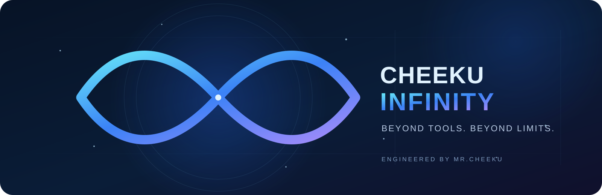

 

**Created by [Mr.Cheeku](https://github.com/MrCheeku)**

**A curated collection of AI skills, developer tools, infrastructure and creative applications.**

**Discover · Fetch · Inspect · Update**

[Quick Start](#-quick-start) · [Collection](#-the-collection) · [Commands](#-command-reference) · [Roadmap](#-roadmap) · [Contributing](#-contributing)

**Engineered by [Mr.Cheeku](https://github.com/MrCheeku)**

---

## ✨ What is CHEEKU INFINITY?

**CHEEKU INFINITY** is an open-source collection and command-line source manager that brings 16 independently maintained projects into one organized catalogue.

It covers AI and machine learning, coding-agent skills, software engineering, cybersecurity, web research, UI/UX design, DevOps, productivity and media creation.

Instead of keeping track of many separate repositories manually, CHEEKU INFINITY gives you one place to:

- **Discover** projects by category, type or name.
- **Inspect** what a project does and where its original source lives.
- **Fetch** a selected repository—or the complete collection—on demand.
- **Update** local checkouts without force-overwriting local changes.
- **Track** which projects are downloaded and whether their working trees are modified.
- **Audit** for common license and notice files before reviewing reuse requirements.

> **The idea:** One organized entry point to a universe of useful open-source tools.

## 🚀 Highlights

| Capability | Description |
|---|---|
| 16-project catalogue | A curated index of the repositories selected for CHEEKU INFINITY |
| Three project types | Skills, developer tools and end-user applications clearly separated |
| CLI interface | Simple commands to browse and manage the collection |
| On-demand cloning | Download only what you need, or fetch all projects |
| Safe updates | Fast-forward-only updates; no forced overwrite of local work |
| Local status | See cloned repositories, active branches and uncommitted changes |
| License awareness | Find common license and notice filenames for manual review |
| No runtime dependencies | The CLI uses Python's standard library; Git is required for source operations |

## 🧭 Table of Contents

- [The Collection](#-the-collection)
- [How It Works](#-how-it-works)
- [Quick Start](#-quick-start)
- [Command Reference](#-command-reference)
- [Examples](#-examples)
- [Current Scope](#-current-scope)
- [Project Structure](#-project-structure)
- [Development](#-development)
- [Roadmap](#-roadmap)
- [License & Third-Party Projects](#-license--third-party-projects)
- [Security](#-security)
- [Contributing](#-contributing)

## 🧰 The Collection

CHEEKU INFINITY currently indexes **16 upstream repositories** across eight engineering domains.

### 🤖 AI & Machine Learning

| Project | Type | Purpose |
|---|---|---|
| [MiniMind](https://github.com/jingyaogong/minimind) | Tool / codebase | Learn and experiment with small language-model training |
| [OpenVINO](https://github.com/openvinotoolkit/openvino) | AI toolkit | Optimize and deploy inference on supported hardware |

### 💻 Software Engineering & AI Coding

| Project | Type | Purpose |
|---|---|---|
| [Superpowers](https://github.com/obra/superpowers) | Agent skills | Planning, TDD, debugging and software-development agent workflows |
| [CLI-Anything](https://github.com/HKUDS/CLI-Anything) | Framework / tools | Create command-line interfaces for agent-controllable software |
| [Cursor Plugins](https://github.com/cursor/plugins) | Plugin collection | Extend the Cursor coding-agent environment |

### 🛡️ Cybersecurity & Compliance

| Project | Type | Purpose |
|---|---|---|
| [Claude-BugHunter](https://github.com/elementalsouls/Claude-BugHunter) | Agent skill bundle | Security workflows for authorized vulnerability assessment |
| [App Store Compliance](https://github.com/mjmirza/app-store-compliance) | Playbook / checks | App-store compliance guidance and pre-submission checks |

### 🔎 Research & Web Intelligence

| Project | Type | Purpose |
|---|---|---|
| [Firecrawl](https://github.com/firecrawl/firecrawl) | Tool / service | Crawl, scrape, search and extract website content |
| [Last30Days Skill](https://github.com/mvanhorn/last30days-skill) | Agent skill | Research recent online discussions and trends |

### 🎨 Design & Documentation

| Project | Type | Purpose |
|---|---|---|
| [Diagram Design](https://github.com/cathrynlavery/diagram-design) | Agent skill | Guidance for technical and visual diagrams |
| [Stitch Skills](https://github.com/google-labs-code/stitch-skills) | Agent skills | UI/UX design workflows using Google Stitch |

### ⚙️ DevOps & Infrastructure

| Project | Type | Purpose |
|---|---|---|
| [NGINX](https://github.com/nginx/nginx) | Server software | Web serving, reverse proxying and traffic distribution |
| [OpenSRE](https://github.com/Tracer-Cloud/opensre) | CLI agent / tool | AI-assisted CI/CD and reliability troubleshooting |

### 🗂️ Productivity

| Project | Type | Purpose |
|---|---|---|
| [AFFiNE](https://github.com/toeverything/AFFiNE) | Application | Documents, notes and visual knowledge workspace |
| [Ghost Downloader 3](https://github.com/XiaoYouChR/Ghost-Downloader-3) | Application | Desktop download management |

### 🎬 Media & Video

| Project | Type | Purpose |
|---|---|---|
| [AutoClip](https://github.com/zhouxiaoka/autoclip) | Application | AI-assisted long-to-short video clipping |

### Collection breakdown

| Type | Count |
|---|---:|
| Agent skills, plugins and playbooks | 7 |
| Developer tools, frameworks and services | 6 |
| Applications | 3 |
| **Total** | **16** |

These labels are broad discovery categories. They do not mean every project is a standalone application or that every project is already integrated into a common runtime.

## 🧩 How It Works

CHEEKU INFINITY keeps its own CLI and catalogue separate from the upstream software.

~~~mermaid
flowchart TD
    USER["You"] --> CLI["CHEEKU INFINITY CLI"]
    CLI --> CAT["Project Catalogue"]
    CLI --> GIT["Git Source Manager"]
    CAT --> INFO["Project details and setup notes"]
    GIT --> LOCAL["Local sources/ directory"]
    LOCAL --> SKILLS["Agent Skills & Plugins"]
    LOCAL --> TOOLS["Developer Tools & Services"]
    LOCAL --> APPS["Applications"]
~~~

When you request a project, the CLI clones it from its original GitHub repository into the local sources/project-id/ directory. Each upstream project keeps its own code, Git history, setup process and license.

## ⚡ Quick Start

### Requirements

- **Python 3.10 or newer**
- **Git** installed and available on your PATH
- An internet connection to fetch upstream repositories

### 1. Clone CHEEKU INFINITY

~~~bash
git clone https://github.com/MrCheeku/cheeku-infinity.git
cd cheeku-infinity
~~~

### 2. Install the command-line tool

**Windows PowerShell**

~~~powershell
py -m pip install .
~~~

**Linux / macOS**

~~~bash
python3 -m pip install .
~~~

For development, install the optional test dependency too:

~~~bash
python -m pip install -e ".[dev]"
~~~

### 3. Verify the installation

~~~bash
cheeku-infinity --version
cheeku-infinity doctor
~~~

### 4. Explore the catalogue

~~~bash
cheeku-infinity list
cheeku-infinity info superpowers
~~~

### 5. Fetch a project

~~~bash
cheeku-infinity clone superpowers
~~~

The source is downloaded to the local sources/superpowers/ directory. Read that project's own README and follow its official installation steps to use it.

To fetch all 16 projects:

~~~bash
cheeku-infinity clone --all
~~~

> **Note:** Cloning the full collection may use substantial bandwidth and disk space. The clone command downloads source code only. It does not run third-party installation scripts, install all dependencies or launch the downloaded software.

## ⌨️ Command Reference

| Command | Description |
|---|---|
| cheeku-infinity --version | Show the installed version |
| cheeku-infinity --help | Show CLI help |
| cheeku-infinity list | List all catalogue projects |
| cheeku-infinity list --kind skill | Filter agent skills and plugins |
| cheeku-infinity list --kind tool | Filter developer tools |
| cheeku-infinity list --kind application | Filter applications |
| cheeku-infinity list --domain research | Filter by domain text |
| cheeku-infinity list --json | Print catalogue data as JSON |
| cheeku-infinity info PROJECT_ID | Display project details and setup notes |
| cheeku-infinity clone PROJECT_ID | Clone one upstream project |
| cheeku-infinity clone --all | Clone all 16 upstream projects |
| cheeku-infinity update PROJECT_ID | Fast-forward update one local checkout |
| cheeku-infinity update --all | Update projects already cloned locally |
| cheeku-infinity status | Show clone state, branch and local changes |
| cheeku-infinity status --json | Print local status as JSON |
| cheeku-infinity audit | Check common license/notice filenames and local changes |
| cheeku-infinity doctor | Check Python, Git and catalogue prerequisites |

For command-specific options, run the command followed by --help.

## 🧪 Examples

### Browse only AI-related tools

~~~bash
cheeku-infinity list --domain "AI"
~~~

### Get details before downloading

~~~bash
cheeku-infinity info firecrawl
~~~

### Keep a local checkout up to date

~~~bash
cheeku-infinity update superpowers
~~~

Updates use a fast-forward-only Git pull. If the local branch has diverged, Git refuses the update instead of force-overwriting your work.

### Check the collection

~~~bash
cheeku-infinity status
cheeku-infinity audit
~~~

The audit command only checks for familiar license/notice filenames. It is not a legal review or a license compatibility analyser.

## 📌 Current Scope

CHEEKU INFINITY is being developed transparently. The current release is a working **catalogue and source manager**, not yet an integrated AI operating environment.

| Capability | Status |
|---|---|
| Browse and filter all 16 projects | Implemented |
| Inspect project details and upstream links | Implemented |
| Clone one or all upstream repositories | Implemented |
| Fast-forward update local checkouts | Implemented |
| View local clone and modification status | Implemented |
| Check common license/notice filenames | Implemented |
| Check basic local prerequisites | Implemented |
| Automatic installation recipes for all upstreams | Planned |
| One-command launch of all applications | Planned |
| AI-agent adapters and integrations | Planned |
| Multi-agent orchestration | Planned |
| Unified dashboard | Planned |
| Cross-project automated workflows | Planned |

A project being listed or cloned does not mean that it is installed, configured, launched or integrated.

## 📁 Project Structure

~~~text
cheeku-infinity/
├── cheeku_infinity/
│   ├── __init__.py
│   ├── catalog.py
│   └── cli.py
├── docs/
│   ├── ARCHITECTURE.md
│   ├── CATALOG.md
│   ├── CLI.md
│   ├── INTEGRATION-ROADMAP.md
│   ├── PROJECT-TYPES.md
│   └── SECURITY-GUIDE.md
├── tests/
│   ├── test_catalog.py
│   └── test_cli.py
├── assets/
│   └── cheeku-infinity-banner.svg
├── .github/
│   ├── ISSUE_TEMPLATE/
│   └── workflows/
├── catalog.json
├── pyproject.toml
├── LICENSE
├── THIRD_PARTY_NOTICES.md
├── CONTRIBUTING.md
├── CODE_OF_CONDUCT.md
├── SECURITY.md
└── README.md
~~~

The sources/ directory is created locally when you clone upstream projects and is intentionally excluded from this repository's Git history.

## 🧑‍💻 Development

Create and activate a virtual environment:

~~~bash
python -m venv .venv
~~~

**Windows PowerShell**

~~~powershell
.venv\Scripts\Activate.ps1
~~~

**Linux / macOS**

~~~bash
source .venv/bin/activate
~~~

Install the project and development dependencies:

~~~bash
python -m pip install -e ".[dev]"
~~~

Run the test suite:

~~~bash
python -m pytest -q
~~~

The GitHub Actions workflow checks Python 3.10, 3.11, 3.12 and 3.13.

## 🗺️ Roadmap

- [x] **v0.1** — Initial repository bootstrap.
- [x] **v0.2** — Catalogue, CLI, source cloning, updates, status, audit, documentation and CI.
- [ ] **v0.3** — Verified setup recipes and dependency preflight checks.
- [ ] **v0.4** — Optional adapters for compatible AI-agent environments.
- [ ] **v0.5** — Tested and permission-controlled workflows connecting selected tools.
- [ ] **v1.0** — Mature integration experience; consider a dashboard after workflows are reliable.

Ideas and improvements can be proposed through [GitHub Issues](https://github.com/MrCheeku/cheeku-infinity/issues).

## 📜 License & Third-Party Projects

The original CHEEKU INFINITY catalogue, CLI code and documentation are licensed under the [MIT License](LICENSE), unless a file states otherwise.

The 16 referenced upstream projects are **not relicensed by this repository**. Their code, names, logos, assets, dependencies and trademarks remain subject to their respective owners' terms. Before modifying, bundling, redistributing or using an upstream project commercially:

1. Read its current license and notices.
2. Check the licenses of bundled dependencies, models, datasets and assets.
3. Preserve all required copyright and attribution notices.
4. Check trademark and branding restrictions separately.

See [THIRD_PARTY_NOTICES.md](THIRD_PARTY_NOTICES.md). CHEEKU INFINITY is an independent collection and is not affiliated with or endorsed by the upstream projects.

## 🔐 Security

- Only test systems you own or are explicitly authorized to assess.
- Review third-party source code and installation scripts before executing them.
- Use isolated environments and least-privilege accounts.
- Never commit passwords, API keys, tokens or private data.
- Treat downloaded source and AI-generated output as untrusted until reviewed.

Read [SECURITY.md](SECURITY.md) and the [Security Guide](docs/SECURITY-GUIDE.md).

## 🤝 Contributing

Contributions are welcome!

1. Read [CONTRIBUTING.md](CONTRIBUTING.md).
2. Open an issue before making large changes.
3. Keep tests and documentation up to date.
4. Preserve upstream attribution and license boundaries.

Please follow the [Code of Conduct](CODE_OF_CONDUCT.md).

---

### ∞ CHEEKU INFINITY

**Beyond Tools. Beyond Limits.**

*Engineered by [Mr.Cheeku](https://github.com/MrCheeku)*

